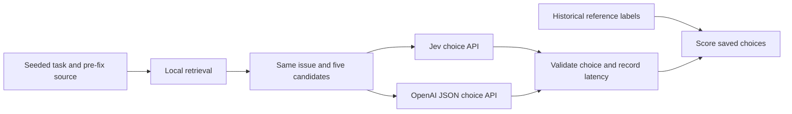

# Exactly where Jev is introduced

Jev is used as an external **choice API**, not as code installed in pytest, Django, SymPy, or any other sampled repository. This project does not contain Jev's model implementation. It calls the existing Typesafe-hosted endpoint using an API key from the environment.



Reference labels feed scoring, not local retrieval or the provider request builder. Both providers operate independently; OpenAI never sees Jev's answer and Jev never sees OpenAI's answer.

## Code locations

| File | Function or block | Jev's role |
|---|---|---|
| `experiment-1/screen.mjs` | optional `--jev` block after `retrieve()` | Choose among five retrieved boltons modules; current perfect baseline skips this path |
| `experiment-1/pytest-screen/run.mjs` | per-task `fetch()` | Send prebuilt five-file pytest request; read choice and score it |
| `experiment-1/compare.mjs` | live Jev block within `run()` | Use stored Jev results or live `--force-jev`; independently call OpenAI |
| `experiment-2/bench.mjs` | `bodies()` and `call()` | Build schema-specific Jev body; send it; validate choice; record response |
| `experiment-3/bench.mjs` | `bodies()` and `call()` | Same Jev integration after the new local BM25 retrieval stage |

`prepare()` retrieves repository source and builds candidates locally. `bodies()` wraps only the issue and candidate evidence. `call()` performs the actual request:

```text
POST https://api.typesafe.ai/v1/systemone
Authorization: Bearer <TYPESAFE_API_KEY from environment>

model: jev-latest
state.issue: original issue text
questions.file.type: choice
questions.file.instructions: fixed selector instruction
questions.file.criteria: f0 ... f4, each containing path and source snippet
```

The returned `answers.file.choice` must be one of `f0` through `f4`. The harness maps the key back to the candidate file and checks reference overlap after the response. The recorded returned Jev model for the completed runs was `jev-1.13.0`; `jev-latest` is a requested alias, not a promise of an immutable future version.

OpenAI is called separately at `https://api.openai.com/v1/chat/completions`, with `gpt-6-astra`, matching issue/candidate text, and JSON choice output. Neither API receives reference labels, historical solution patches, test-patch labels or the other provider's answer.

Jev was **not** introduced into task sampling, local BM25 scoring, candidate path boosts, source snippets, historical patches, upstream source files or test runners. No bug-fix code is generated here. API keys and request Authorization headers are not included in the publication reports.
